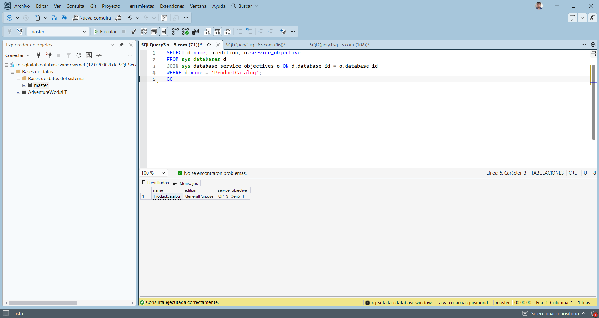
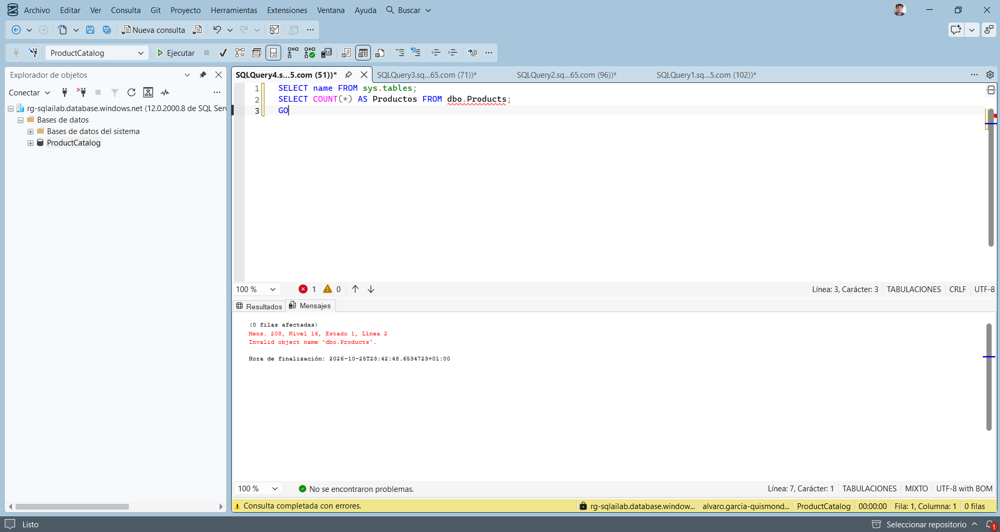
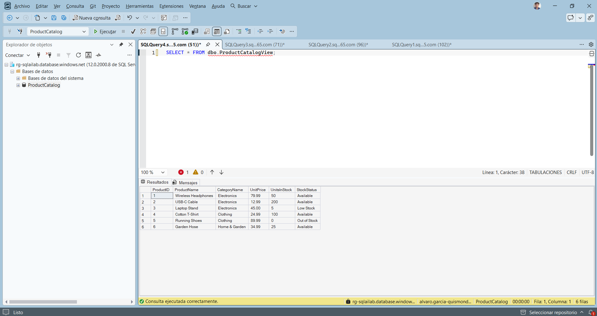
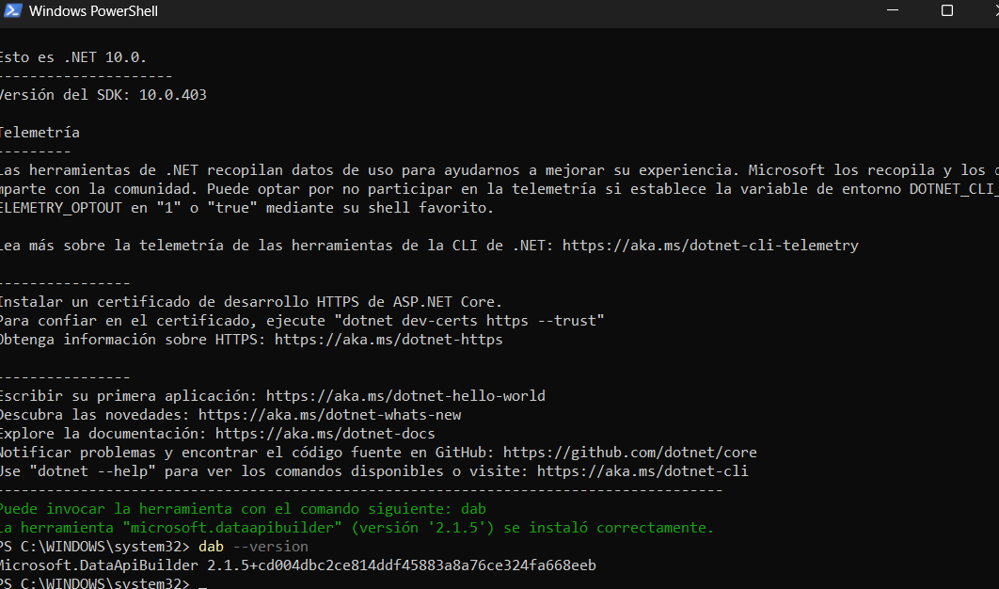
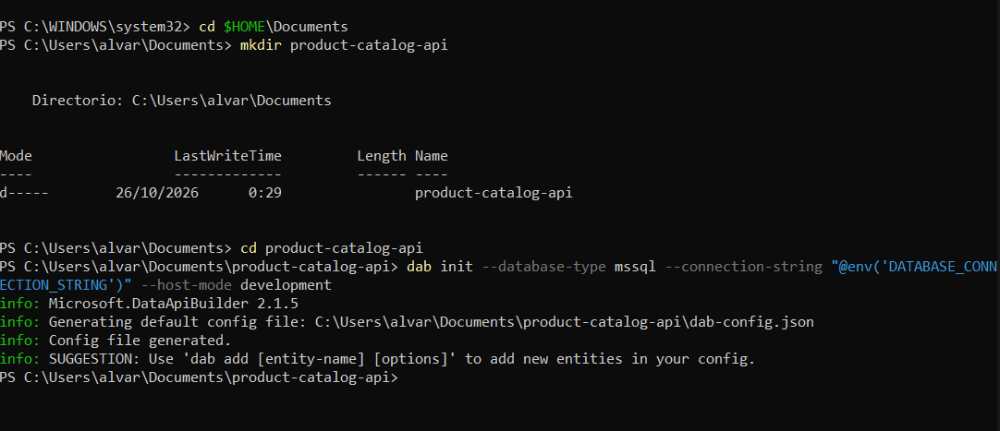
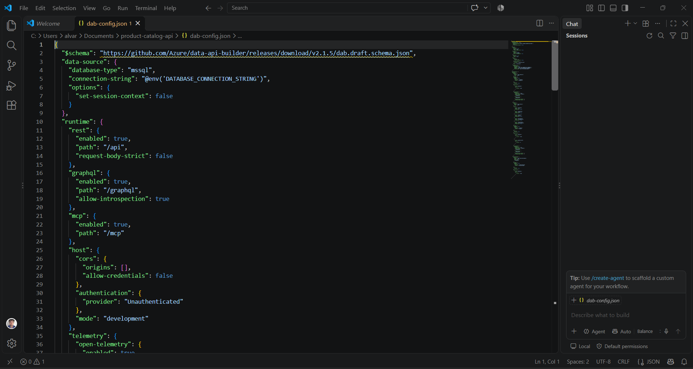
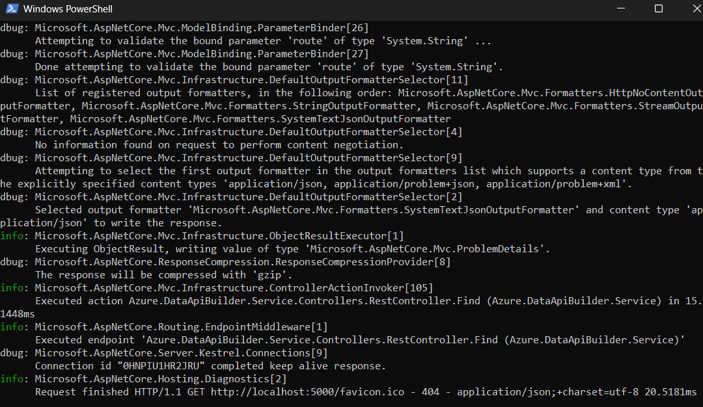
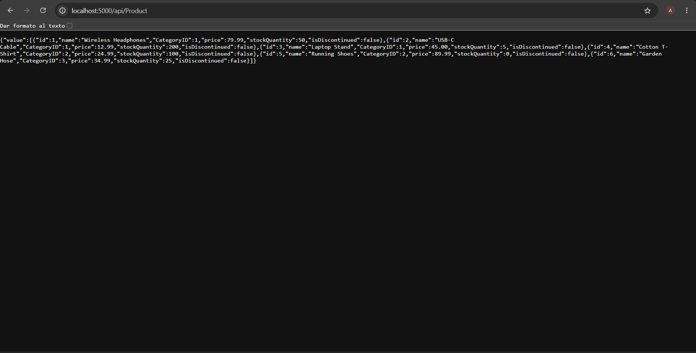
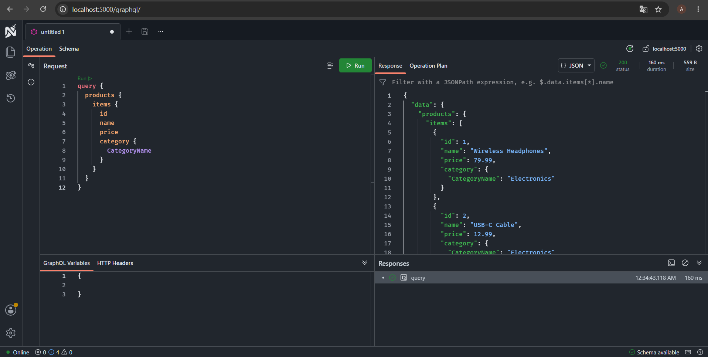

# API REST y GraphQL sobre SQL con Data API Builder

Integrate SQL solutions with Azure services

Álvaro García-Quismondo Lizana · 26 de octubre de 2026

## Contenido

- 1. Objetivo y entorno
- 2. Base de datos de ejemplo
- 3. Instalación de Data API Builder
- 4. Proyecto y configuración inicial
- 5. Entidades, mapeos y relaciones
- 6. Pruebas en local
- 7. Resumen de incidencias
- 8. Observaciones
- 9. Archivos incluidos

## 1. Objetivo y entorno

En esta práctica expongo una base de datos SQL como API con Data API Builder (DAB). DAB lee un archivo de configuración y publica endpoints REST y GraphQL sobre tablas y vistas sin escribir código. Configuro tres entidades de un catálogo de productos (dos tablas y una vista), añado nombres de campo propios y relaciones entre tablas, y pruebo las dos APIs en local.

La base de datos `ProductCatalog` es nueva y no tiene que ver con las de las prácticas anteriores, aunque la creo en el mismo servidor de Azure SQL. DAB se ejecuta en mi portátil y se conecta a la base con mi identidad de Microsoft Entra, sin contraseñas en ningún archivo.

| Elemento | Valor |
|---|---|
| Suscripción | Azure for Students |
| Servidor SQL | rg-sqlailab (Spain Central, solo autenticación Microsoft Entra) |
| Base de datos | ProductCatalog, General Purpose serverless (GP_S_Gen5_1) |
| Autenticación de DAB | Active Directory Default, con la sesión de Azure CLI |
| Herramientas en el portátil | .NET SDK 10, Azure CLI, VS Code, Data API Builder 2.1.5 |
| Cliente SQL | SQL Server Management Studio |
| Endpoints locales | http://localhost:5000/api y http://localhost:5000/graphql |

Además de SSMS instalé en el portátil el SDK de .NET, Azure CLI y VS Code. El motivo de usar el SDK 10 se explica en la sección 3.

## 2. Base de datos de ejemplo

### 2.1 Creación de la base de datos

Creé la base desde `master`. Añadí la edición y el objetivo de servicio al `CREATE DATABASE` del enunciado para que sea serverless: sin ellos Azure puede crear una base provisionada, que gasta mucho más crédito de la suscripción de estudiante.

```sql
CREATE DATABASE ProductCatalog (EDITION = 'GeneralPurpose', SERVICE_OBJECTIVE = 'GP_S_Gen5_1');
GO
```

Más tarde, al ejecutarlo de nuevo, SQL Server respondió con el error 1801: la base ya existía de un intento anterior. Comprobé con una consulta sobre `sys.database_service_objectives` que seguía siendo serverless.

```sql
-- Comprobar edición y objetivo de servicio
SELECT d.name, o.edition, o.service_objective
FROM sys.databases d
JOIN sys.database_service_objectives o ON d.database_id = o.database_id
WHERE d.name = 'ProductCatalog';
GO
```



*Figura 1. La base ProductCatalog es General Purpose con objetivo de servicio GP_S_Gen5_1.*

### 2.2 Tablas, vista y datos

El script del enunciado crea las tablas `Categories` y `Products`, esta con clave foránea hacia la primera, y la vista `ProductCatalogView`, que une las dos, excluye los productos descontinuados y calcula un estado de existencias (Out of Stock, Low Stock o Available). Después inserta 3 categorías y 6 productos.

El Explorador de objetos de SSMS no mostraba `ProductCatalog`, porque mi conexión estaba abierta contra `AdventureWorksLT` y solo ve esa base. Abrí una conexión nueva indicando `ProductCatalog` como base de datos en las opciones de conexión. La primera consulta ahí dio el error 208 (`Invalid object name 'dbo.Products'`), porque la base estaba vacía: faltaba ejecutar el script.



*Figura 2. Error 208 al consultar dbo.Products en la base recién creada y todavía vacía.*

```sql
CREATE TABLE dbo.Categories (
    CategoryID INT IDENTITY(1,1) PRIMARY KEY,
    CategoryName NVARCHAR(50) NOT NULL,
    Description NVARCHAR(200)
);

CREATE TABLE dbo.Products (
    ProductID INT IDENTITY(1,1) PRIMARY KEY,
    ProductName NVARCHAR(100) NOT NULL,
    CategoryID INT NOT NULL,
    UnitPrice DECIMAL(10,2) NOT NULL,
    UnitsInStock INT NOT NULL DEFAULT 0,
    Discontinued BIT NOT NULL DEFAULT 0,
    CONSTRAINT FK_Products_Categories
        FOREIGN KEY (CategoryID) REFERENCES dbo.Categories(CategoryID)
);
GO

CREATE VIEW dbo.ProductCatalogView AS
SELECT
    p.ProductID,
    p.ProductName,
    c.CategoryName,
    p.UnitPrice,
    p.UnitsInStock,
    CASE
        WHEN p.UnitsInStock = 0 THEN 'Out of Stock'
        WHEN p.UnitsInStock < 10 THEN 'Low Stock'
        ELSE 'Available'
    END AS StockStatus
FROM dbo.Products p
INNER JOIN dbo.Categories c ON p.CategoryID = c.CategoryID
WHERE p.Discontinued = 0;
GO

INSERT INTO dbo.Categories (CategoryName, Description) VALUES
('Electronics', 'Electronic devices and accessories'),
('Clothing', 'Apparel and fashion items'),
('Home & Garden', 'Products for home improvement');

INSERT INTO dbo.Products (ProductName, CategoryID, UnitPrice, UnitsInStock) VALUES
('Wireless Headphones', 1, 79.99, 50),
('USB-C Cable', 1, 12.99, 200),
('Laptop Stand', 1, 45.00, 5),
('Cotton T-Shirt', 2, 24.99, 100),
('Running Shoes', 2, 89.99, 0),
('Garden Hose', 3, 34.99, 25);
GO
```

Para comprobar el resultado consulté la vista. Salen las 6 filas: Running Shoes aparece como Out of Stock, con 0 unidades, porque la vista solo filtra los productos descontinuados y ninguno lo está.

```sql
SELECT * FROM dbo.ProductCatalogView;
GO
```



*Figura 3. Contenido de ProductCatalogView: 6 productos con su categoría y su estado de existencias.*

## 3. Instalación de Data API Builder

DAB se instala como herramienta global de .NET. El portátil no tenía `winget`, así que descargué los instaladores del SDK de .NET, de Azure CLI y de VS Code desde PowerShell. Con el SDK 8, que es el que indican el enunciado y la documentación de Microsoft, la instalación de DAB falló:

```sql
dotnet tool install --global Microsoft.DataApiBuilder

La herramienta "microsoft.dataapibuilder" no se pudo actualizar debido a lo siguiente:
El archivo de configuración del paquete NuGet de la herramienta no es válido: El archivo de
configuración "DotnetToolSettings.xml" no se encontró en el paquete.
```

El mensaje es engañoso. La versión actual de DAB, la 2.1.5 de octubre de 2026, apunta a .NET 10, y cuando el SDK instalado es más antiguo que lo que pide la herramienta, .NET informa de un archivo ausente en lugar de una incompatibilidad. Instalé el SDK 10, que convive con el 8, y repetí la instalación.

```sql
dotnet tool install --global Microsoft.DataApiBuilder
dab --version
```



*Figura 4. Instalación correcta de Data API Builder 2.1.5 con el SDK 10 de .NET.*

## 4. Proyecto y configuración inicial

Creo la carpeta del proyecto y el archivo de configuración con `dab init`. La cadena de conexión no se escribe en el archivo: se indica con `@env(...)` y DAB la lee de la variable de entorno `DATABASE_CONNECTION_STRING` al arrancar, de modo que no queda ningún secreto en el proyecto.

Al principio `mkdir` dio «Acceso denegado». PowerShell se había abierto en `C:\WINDOWS\system32`, una carpeta del sistema donde no se puede escribir. Me cambié a Documentos y desde ahí funcionó.

```sql
cd $HOME\Documents
mkdir product-catalog-api
cd product-catalog-api
dab init --database-type mssql --connection-string "@env('DATABASE_CONNECTION_STRING')" --host-mode development
```



*Figura 5. Creación del proyecto y de dab-config.json con dab init.*

El archivo generado por esta versión incluye apartados que el enunciado no muestra en su ejemplo: un bloque `mcp` habilitado en `/mcp`, la telemetría de OpenTelemetry, `allow-introspection` en GraphQL, `request-body-strict` en REST y la opción `set-session-context`. Los valores esenciales coinciden con los del enunciado: REST en `/api`, GraphQL en `/graphql`, modo development y la cadena de conexión como variable de entorno.



*Figura 6. Principio de dab-config.json: origen de datos, REST, GraphQL y modo development.*

## 5. Entidades, mapeos y relaciones

El enunciado propone editar el JSON a mano. En su lugar usé los comandos de la CLI de DAB que producen el mismo resultado, para evitar errores al copiar. Cada comando hace lo siguiente:

- `dab add Category` y `dab add Product` publican las dos tablas con lectura anónima.
- `dab update Product --permissions "authenticated:*"` añade al rol authenticated todas las operaciones sobre Product.
- `--map` renombra las columnas de Product: ProductID a id, ProductName a name, UnitPrice a price, UnitsInStock a stockQuantity y Discontinued a isDiscontinued.
- Las dos llamadas con `--relationship` crean la relación `category` (de producto a categoría, cardinalidad one) y la inversa `products` (de categoría a productos, cardinalidad many), ambas enlazadas por CategoryID.
- `dab add ProductCatalog` publica la vista como entidad de solo lectura. Hay que indicar `--source.key-fields` porque DAB no puede detectar la clave primaria de una vista.

```sql
dab add Category --source dbo.Categories --permissions "anonymous:read"
dab add Product --source dbo.Products --permissions "anonymous:read"
dab update Product --permissions "authenticated:*"
dab update Product --map "ProductID:id,ProductName:name,UnitPrice:price,UnitsInStock:stockQuantity,Discontinued:isDiscontinued"
dab update Product --relationship category --target.entity Category --cardinality one --relationship.fields "CategoryID:CategoryID"
dab update Category --relationship products --target.entity Product --cardinality many --relationship.fields "CategoryID:CategoryID"
dab add ProductCatalog --source dbo.ProductCatalogView --source.type view --source.key-fields "ProductID" --permissions "anonymous:read"
```

Esta es la sección de entidades que quedó en `dab-config.json`. Respecto al ejemplo del enunciado hay diferencias de formato de la versión 2.1.5: los mapeos aparecen como una lista `fields` con un `alias` por campo en lugar de un bloque `mappings`, los permisos son objetos con `action`, y cada entidad lleva sus bloques `graphql` y `rest` con los nombres singular y plural. La vista no tiene `"operation": "query"`, que el enunciado muestra en su ejemplo.

```sql
  "entities": {
    "Category": {
      "source": {
        "object": "dbo.Categories",
        "type": "table"
      },
      "fields": [],
      "graphql": {
        "enabled": true,
        "type": {
          "singular": "Category",
          "plural": "Categories"
        }
      },
      "rest": {
        "enabled": true
      },
      "permissions": [
        {
          "role": "anonymous",
          "actions": [
            {
              "action": "read"
            }
          ]
        }
      ],
      "relationships": {
        "products": {
          "cardinality": "many",
          "target.entity": "Product",
          "source.fields": [
            "CategoryID"
          ],
          "target.fields": [
            "CategoryID"
          ],
          "linking.source.fields": [],
          "linking.target.fields": []
        }
      }
    },
    "Product": {
      "source": {
        "object": "dbo.Products",
        "type": "table"
      },
      "fields": [
        {
          "name": "ProductID",
          "alias": "id",
          "primary-key": false
        },
        {
          "name": "ProductName",
          "alias": "name",
          "primary-key": false
        },
        {
          "name": "UnitPrice",
          "alias": "price",
          "primary-key": false
        },
        {
          "name": "UnitsInStock",
          "alias": "stockQuantity",
          "primary-key": false
        },
        {
          "name": "Discontinued",
          "alias": "isDiscontinued",
          "primary-key": false
        }
      ],
      "graphql": {
        "enabled": true,
        "type": {
          "singular": "Product",
          "plural": "Products"
        }
      },
      "rest": {
        "enabled": true
      },
      "permissions": [
        {
          "role": "anonymous",
          "actions": [
            {
              "action": "read"
            }
          ]
        },
        {
          "role": "authenticated",
          "actions": [
            {
              "action": "*"
            }
          ]
        }
      ],
      "relationships": {
        "category": {
          "cardinality": "one",
          "target.entity": "Category",
          "source.fields": [
            "CategoryID"
          ],
          "target.fields": [
            "CategoryID"
          ],
          "linking.source.fields": [],
          "linking.target.fields": []
        }
      }
    },
    "ProductCatalog": {
      "source": {
        "object": "dbo.ProductCatalogView",
        "type": "view",
        "key-fields": [
          "ProductID"
        ]
      },
      "graphql": {
        "enabled": true,
        "type": {
          "singular": "ProductCatalog",
          "plural": "ProductCatalogs"
        }
      },
      "rest": {
        "enabled": true
      },
      "permissions": [
        {
          "role": "anonymous",
          "actions": [
            {
              "action": "read"
            }
          ]
        }
      ]
    }
  }
```

## 6. Pruebas en local

### 6.1 Arranque

Antes de arrancar inicié sesión con Azure CLI (`az login`), porque `Active Directory Default` toma la identidad de esa sesión. La variable de entorno solo existe en la ventana de PowerShell donde se define, así que `dab start` se lanza desde la misma.

```sql
$env:DATABASE_CONNECTION_STRING="Server=rg-sqlailab.database.windows.net;Database=ProductCatalog;Authentication=Active Directory Default;TrustServerCertificate=true"
dab start
```

En modo development DAB escribe en la terminal el registro detallado de cada petición. En la captura se ve la petición a `/api/Product`, atendida por el controlador REST, y un 404 de `favicon.ico`, que es el navegador pidiendo el icono de la pestaña y no afecta a la API.



*Figura 7. Registro de DAB en la terminal mientras atiende las peticiones.*

### 6.2 Endpoint REST

`http://localhost:5000/api/Product` devuelve los 6 productos dentro de una propiedad `value`. Los campos salen con los nombres definidos en la configuración: id, name, price, stockQuantity e isDiscontinued. `CategoryID` conserva su nombre original porque no está en la lista de alias.



*Figura 8. Respuesta REST de /api/Product con los campos renombrados.*

### 6.3 Consulta GraphQL

En `http://localhost:5000/graphql` ejecuté una consulta sobre `products` que pide id, name, price y, a través de la relación `category`, el nombre de la categoría. La respuesta fue 200 en 160 ms, con cada producto acompañado de su categoría, lo que confirma que la relación funciona. El nombre `products` sale del plural que DAB asigna a la entidad Product.

```sql
query {
  products {
    items {
      id
      name
      price
      category {
        CategoryName
      }
    }
  }
}
```



*Figura 9. Consulta GraphQL en el editor de DAB y principio de la respuesta.*

La respuesta completa, con los 6 productos y sus categorías:

```sql
{
  "data": {
    "products": {
      "items": [
        { "id": 1, "name": "Wireless Headphones", "price": 79.99, "category": { "CategoryName": "Electronics" } },
        { "id": 2, "name": "USB-C Cable", "price": 12.99, "category": { "CategoryName": "Electronics" } },
        { "id": 3, "name": "Laptop Stand", "price": 45, "category": { "CategoryName": "Electronics" } },
        { "id": 4, "name": "Cotton T-Shirt", "price": 24.99, "category": { "CategoryName": "Clothing" } },
        { "id": 5, "name": "Running Shoes", "price": 89.99, "category": { "CategoryName": "Clothing" } },
        { "id": 6, "name": "Garden Hose", "price": 34.99, "category": { "CategoryName": "Home & Garden" } }
      ]
    }
  }
}
```

## 7. Resumen de incidencias

| Incidencia | Causa | Solución |
|---|---|---|
| Error 1801, la base ya existe | La base se había creado en un intento anterior | Comprobar edición y objetivo de servicio con una consulta |
| El Explorador no muestra ProductCatalog | La conexión estaba abierta contra AdventureWorksLT | Nueva conexión con ProductCatalog como base de datos |
| Error 208, Invalid object name dbo.Products | La base estaba vacía | Ejecutar el script de tablas, vista y datos |
| winget no disponible | Portátil recién formateado | Instaladores descargados desde PowerShell |
| Falla la instalación de DAB (DotnetToolSettings.xml) | DAB 2.1.5 apunta a .NET 10 y el SDK 8 no basta | Instalar el SDK 10 |
| mkdir con acceso denegado | PowerShell abierto en C:\WINDOWS\system32 | Trabajar desde la carpeta Documentos |

## 8. Observaciones

La configuración declara lectura anónima en las tres entidades y todas las operaciones para el rol authenticated en Product. En la prueba solo usé lectura anónima: el proveedor de autenticación de DAB es Unauthenticated, así que las operaciones de escritura no se ejercitaron. Tampoco consulté la entidad ProductCatalog (la vista) desde REST ni GraphQL, aunque queda publicada.

La introducción del enunciado habla de desplegar la API en Azure, pero los pasos solo cubren la prueba en local, y eso es lo que hice. La documentación de Microsoft que consulté sigue indicando .NET 8 como requisito de DAB, pero la versión actual necesita el SDK 10.

El enunciado termina con una limpieza (borrar la base ProductCatalog y la carpeta del proyecto). El script está en `sql/04-limpieza.sql` y la configuración queda guardada en `dab/dab-config.json`.

## 9. Archivos incluidos

| Archivo | Contenido |
|---|---|
| sql/01-crear-base-datos.sql | Creación de ProductCatalog serverless y comprobación |
| sql/02-tablas-vista-datos.sql | Tablas, vista y datos de ejemplo |
| sql/03-verificacion.sql | Comprobación de tablas y de la vista |
| sql/04-limpieza.sql | Borrado de la base al terminar el laboratorio |
| dab/dab-config.json | Configuración de DAB generada con la CLI |
| dab/comandos.ps1 | Comandos de PowerShell en el orden en que los ejecuté |
| dab/consulta-graphql.graphql | Consulta GraphQL de la prueba |
| dab/respuesta-graphql.json | Respuesta de la consulta GraphQL |
